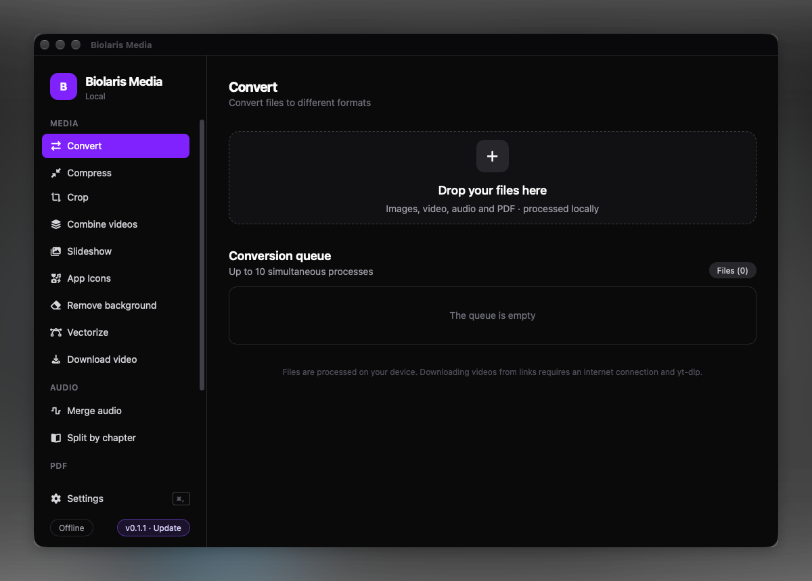
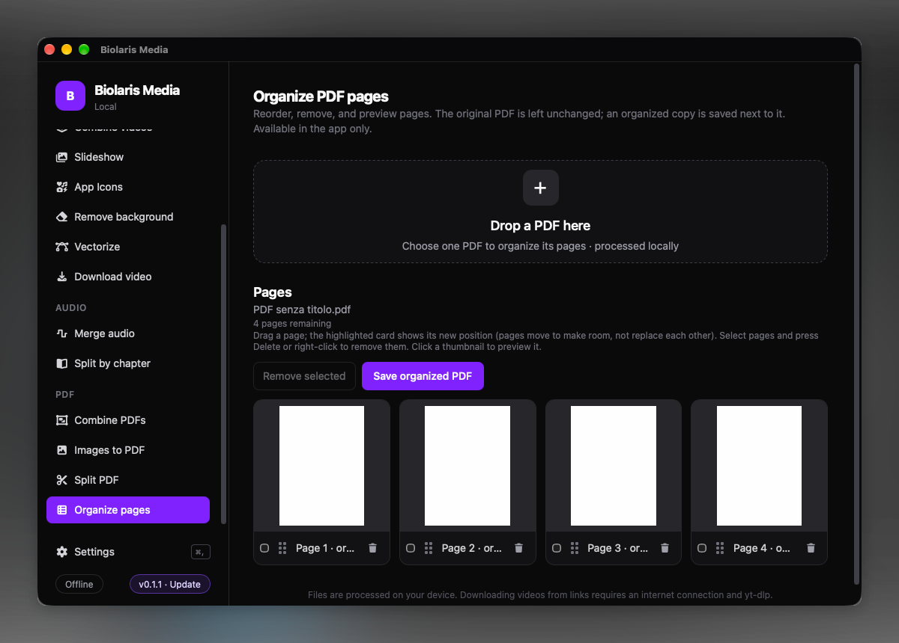

<div align="center">
  
  <h1>Biolaris Media</h1>
  <p><strong>Strumenti multimediali, direttamente sul tuo desktop.</strong></p>
  <p>Una raccolta desktop, local-first, per convertire e comprimere file multimediali e lavorare con immagini e PDF.</p>
  <p><strong>🇮🇹 Italiano</strong> · <a href="README.md">🇬🇧 English</a></p>
  <p>
    <a href="https://github.com/bispitalieri/biolaris-media/releases">
      
    </a>
    <a href="https://github.com/bispitalieri/biolaris-media/releases">
      
    </a>
    <a href="LICENSE">
      
    </a>
    <a href="https://github.com/bispitalieri/biolaris-media/actions/workflows/ci.yml">
      
    </a>
    <a href="https://github.com/bispitalieri/biolaris-media/issues">
      
    </a>
    <a href="https://github.com/bispitalieri/biolaris-media/releases">
      
    </a>
    <a href="https://github.com/bispitalieri/biolaris-media/releases">
      
    </a>
    <a href="https://github.com/bispitalieri/biolaris-media/releases">
      
    </a>
  </p>
  <p>
    <a href="#anteprima">Anteprima</a> ·
    <a href="#funzionalità">Funzionalità</a> ·
    <a href="#perché-biolaris">Perché Biolaris?</a> ·
    <a href="#download">Download</a> ·
    <a href="#compilare-dai-sorgenti">Compilare dai sorgenti</a> ·
    <a href="#documentazione">Documentazione</a> ·
    <a href="#contribuire">Contribuire</a>
  </p>
</div>

Biolaris riunisce in un’unica applicazione desktop strumenti di uso quotidiano per file multimediali. Scegli uno strumento, aggiungi i file, configura le opzioni e segui l’avanzamento delle operazioni. Conversione ed elaborazione avvengono sul tuo computer: i file non vengono inviati a un servizio di conversione online.

> **Stato del progetto:** Biolaris è in sviluppo attivo. I formati supportati variano in base allo strumento e ai codec inclusi. Non è stata pubblicata una roadmap.

## Anteprima

Gli screenshot qui sotto mostrano l’app attuale: l’area di conversione principale e lo strumento per organizzare le pagine PDF.

<table>
  <tr>
    <td align="center">
      
      <br><strong>Converti i media nell’area desktop locale</strong>
    </td>
  </tr>
  <tr>
    <td align="center">
      
      <br><strong>Visualizza, riordina e organizza le pagine PDF</strong>
    </td>
  </tr>
</table>

## Funzionalità

<table>
  <tr>
    <td width="50%" valign="top">
      <h3>Conversione e compressione</h3>
      <p>Converti i formati immagine, audio e video supportati. I formati di output disponibili dipendono dal file di origine e dai codec installati. Comprimi immagini, alcuni formati video e audio MP3/OGG regolando la qualità.</p>
    </td>
    <td width="50%" valign="top">
      <h3>Strumenti per immagini</h3>
      <p>Ritaglia immagini, rimuovi lo sfondo da immagini JPG/PNG/WebP, traccia immagini raster creando tracciati SVG e genera pacchetti di icone per Windows, macOS, iOS, Android e progetti web.</p>
    </td>
  </tr>
  <tr>
    <td width="50%" valign="top">
      <h3>Audio e video</h3>
      <p>Crea slideshow MP4, combina video, unisci tracce audio (con marcatori di capitolo M4B facoltativi), dividi file multimediali in base ai capitoli e scarica video da link supportati.</p>
    </td>
    <td width="50%" valign="top">
      <h3>Strumenti PDF</h3>
      <p>Unisci PDF, dividili per intervalli di pagine, riordina o rimuovi pagine salvando una nuova copia e crea PDF da immagini. I PDF protetti da password devono essere sbloccati prima dell’elaborazione.</p>
    </td>
  </tr>
</table>

Consulta la [guida alle funzionalità e ai formati](.github/docs/FEATURES.it.md) per i formati di input/output e i limiti specifici di ogni strumento.

## Perché Biolaris?

Biolaris riunisce conversione multimediale, strumenti per immagini e utility PDF in un’interfaccia desktop nativa. L’elaborazione resta sul tuo computer; Rust e Tauri alimentano l’app desktop per le build attualmente pubblicate per Windows, macOS e Linux. Il progetto è open source con licenza AGPL-3.0-only.

### Elaborazione locale

Biolaris è un’app desktop nativa realizzata con Tauri 2, Rust, React e TypeScript. Gli strumenti multimediali inclusi elaborano i file selezionati localmente. Al primo utilizzo, la rimozione dello sfondo scarica il modello (circa 183 MB), che viene poi eseguito localmente sulla CPU; per scaricare video serve una connessione Internet. Consulta le [istruzioni di installazione e primo avvio](.github/docs/INSTALLATION.it.md).

## Download

Scarica l’app dalla [pagina ufficiale GitHub Releases](https://github.com/bispitalieri/biolaris-media/releases). Le release attuali includono pacchetti per Windows x64, macOS (Apple silicon e Intel) e Linux x64. Scegli il pacchetto adatto al tuo sistema; i nomi esatti cambiano a ogni release.

| Piattaforma | Pacchetti disponibili |
| --- | --- |
| Windows x64 | Installer `.msi` o `.exe` |
| macOS Apple silicon o Intel | `.dmg` |
| Linux x64 | `.AppImage`, `.deb` o `.rpm` |

Consulta le [istruzioni di installazione](.github/docs/INSTALLATION.it.md) per i dettagli sui pacchetti e la risoluzione dei problemi.

## Compilare dai sorgenti

Installa Node.js, Rust stable/Cargo e i prerequisiti nativi di Tauri per il tuo sistema operativo. Poi esegui:

```sh
git clone https://github.com/bispitalieri/biolaris-media.git
cd biolaris-media
npm ci
npm run dev:tauri
```

Per creare una build desktop, esegui `npm run tauri:build`; per compilare solo il frontend, `npm run build`. La configurazione desktop scarica il runtime multimediale adatto alla piattaforma. Consulta le [istruzioni per sviluppo e build](.github/docs/DEVELOPMENT.it.md).

## Documentazione

- [Funzionalità e formati supportati](.github/docs/FEATURES.it.md)
- [Installazione e primo avvio](.github/docs/INSTALLATION.it.md)
- [Sviluppo e build](.github/docs/DEVELOPMENT.it.md)
- [Guida per contribuire](.github/CONTRIBUTING.it.md)
- [Politica di sicurezza](.github/SECURITY.it.md)
- [Codice di condotta](.github/CODE_OF_CONDUCT.it.md)
- [Note sul modello di terze parti (in inglese)](.github/THIRD_PARTY_NOTICES.md)

La documentazione è mantenuta in questo repository; Biolaris non ha un sito o un portale documentale separato.

## Contribuire

Segnala bug e proponi miglioramenti tramite le [GitHub Issues](https://github.com/bispitalieri/biolaris-media/issues). Per modifiche più ampie, apri prima una issue per discuterne, poi invia una pull request mirata. Leggi la [guida per contribuire](.github/CONTRIBUTING.it.md) e rispetta il [Codice di condotta](.github/CODE_OF_CONDUCT.it.md). Per le vulnerabilità, segui in privato la [politica di sicurezza](.github/SECURITY.it.md).

## Sostieni Biolaris

Se Biolaris Media ti è utile, valuta la possibilità di supportarne lo sviluppo:

<div align="center">

[](https://buymeacoffee.com/bspitalieri)
[](https://github.com/sponsors/tranvuongquocdat)

</div>

## Licenza

Biolaris Media è distribuito secondo i termini della licenza **AGPL-3.0-only**. Consulta il file [LICENSE](LICENSE).
