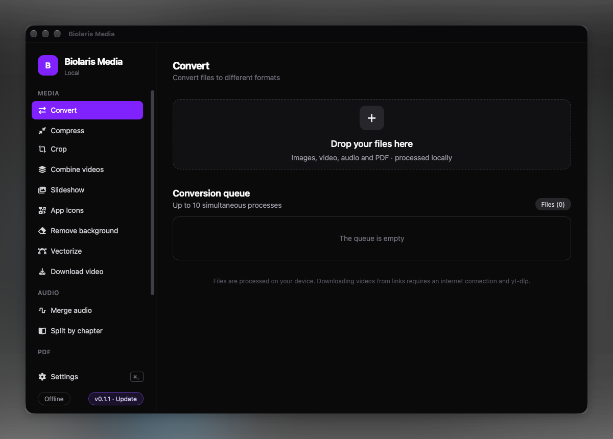
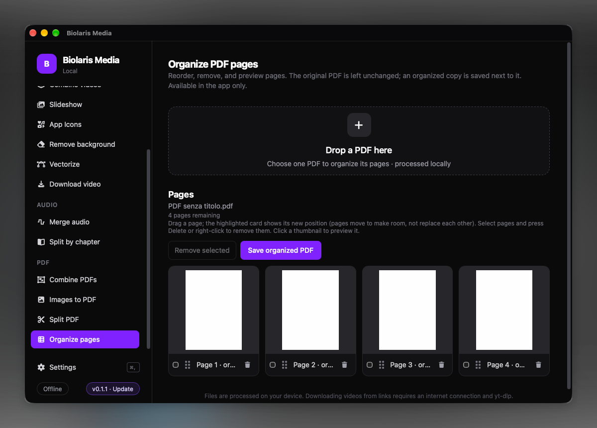

<div align="center">
  
  <h1>Biolaris Media</h1>
  <p><strong>Media tools, kept on your desktop.</strong></p>
  <p>A local-first desktop toolbox for converting, compressing, and working with media files, images, and PDFs.</p>
  <p><a href="README.it.md">🇮🇹 Italiano</a> · <strong>🇬🇧 English</strong></p>
  <p>
    <a href="https://github.com/bispitalieri/biolaris-media/releases">
      
    </a>
    <a href="https://github.com/bispitalieri/biolaris-media/releases">
      
    </a>
    <a href="LICENSE">
      
    </a>
    <a href="https://github.com/bispitalieri/biolaris-media/actions/workflows/ci.yml">
      
    </a>
    <a href="https://github.com/bispitalieri/biolaris-media/issues">
      
    </a>
  </p>
  <p>
    <a href="https://github.com/bispitalieri/biolaris-media/releases">
      
    </a>
    <a href="https://github.com/bispitalieri/biolaris-media/releases">
      
    </a>
    <a href="https://github.com/bispitalieri/biolaris-media/releases">
      
    </a>
  </p>
  <p>
    <a href="#preview">Preview</a> ·
    <a href="#features">Features</a> ·
    <a href="#why-biolaris">Why Biolaris?</a> ·
    <a href="#download">Download</a> ·
    <a href="#build-from-source">Build from source</a> ·
    <a href="#documentation">Documentation</a> ·
    <a href="#contributing">Contributing</a>
  </p>
</div>

Biolaris brings everyday media and file utilities into one desktop app. Choose a tool, add files, adjust its options, and follow the job as it runs. Conversion and processing happen on your computer; files are not sent to a hosted conversion service.

> **Project status:** Biolaris is under active development. Format support varies by tool and bundled codecs. No formal roadmap is published.

## Preview

The screenshots below show the current app: the main conversion workspace and PDF page organizer.

<table>
  <tr>
    <td align="center">
      
      <br><strong>Convert media in the local desktop workspace</strong>
    </td>
  </tr>
  <tr>
    <td align="center">
      
      <br><strong>Preview, reorder, and organize PDF pages</strong>
    </td>
  </tr>
</table>

## Features

<table>
  <tr>
    <td width="50%" valign="top">
      <h3>Convert and compress</h3>
      <p>Convert supported image, audio, and video files. Available output formats depend on the input and codecs in the bundled tools. Compress supported images, selected video formats, and MP3/OGG audio with adjustable quality.</p>
    </td>
    <td width="50%" valign="top">
      <h3>Image tools</h3>
      <p>Crop images, remove backgrounds from JPG/PNG/WebP images, trace raster artwork into SVG paths, and generate icon packages for Windows, macOS, iOS, Android, and web projects.</p>
    </td>
  </tr>
  <tr>
    <td width="50%" valign="top">
      <h3>Audio and video</h3>
      <p>Create MP4 slideshows, combine videos, join audio tracks (with optional M4B chapter markers), split chapter-marked media, and download videos from supported links.</p>
    </td>
    <td width="50%" valign="top">
      <h3>PDF utilities</h3>
      <p>Combine PDFs, split by page ranges, reorder or remove pages in a new copy, and create PDFs from images. Password-protected PDFs must be unlocked before processing.</p>
    </td>
  </tr>
</table>

See the [feature and format reference](.github/docs/FEATURES.md) for per-tool input/output formats and known limitations.

## Why Biolaris?

Biolaris brings media conversion, image work, and PDF utilities together in a native desktop interface. Processing stays on your computer, while Rust and Tauri power the desktop app across the currently released Windows, macOS, and Linux builds. The project is open source under AGPL-3.0-only.

### Local processing

Biolaris is a native desktop app built with Tauri 2, Rust, React, and TypeScript. Its bundled media tools process selected files locally. Background removal downloads its model on first use (about 183 MB), then runs it locally on the CPU; video downloading needs an internet connection. See [installation and first-use notes](.github/docs/INSTALLATION.md).

## Download

Download from the [official GitHub Releases page](https://github.com/bispitalieri/biolaris-media/releases). Releases currently provide packages for Windows x64, macOS (Apple silicon and Intel), and Linux x64. Choose the package for your system; exact filenames vary by release.

| Platform | Release packages |
| --- | --- |
| Windows x64 | `.msi` or `.exe` installer |
| macOS Apple silicon or Intel | `.dmg` |
| Linux x64 | `.AppImage`, `.deb`, or `.rpm` |

See [installation instructions](.github/docs/INSTALLATION.md) for package notes and troubleshooting.

## Build from source

Install Node.js, Rust stable/Cargo, and the native prerequisites for Tauri on your operating system. Then:

```sh
git clone https://github.com/bispitalieri/biolaris-media.git
cd biolaris-media
npm ci
npm run dev:tauri
```

Create a desktop build with `npm run tauri:build`; build only the frontend with `npm run build`. Desktop setup downloads the matching media-tool runtime. See [development and build instructions](.github/docs/DEVELOPMENT.md).

## Documentation

- [Features and supported formats](.github/docs/FEATURES.md)
- [Installation and first use](.github/docs/INSTALLATION.md)
- [Development and builds](.github/docs/DEVELOPMENT.md)
- [Contributing guide](.github/CONTRIBUTING.md)
- [Security policy](.github/SECURITY.md)
- [Code of Conduct](.github/CODE_OF_CONDUCT.md)
- [Third-party model notice](.github/THIRD_PARTY_NOTICES.md)

Documentation is maintained in this repository; Biolaris has no separate website or documentation portal.

## Contributing

Report bugs and suggest improvements through [GitHub Issues](https://github.com/bispitalieri/biolaris-media/issues). For larger changes, open an issue to discuss the approach, then submit a focused pull request. Read the [contributing guide](.github/CONTRIBUTING.md) and follow the [Code of Conduct](.github/CODE_OF_CONDUCT.md). Report security vulnerabilities privately according to the [security policy](.github/SECURITY.md).

## Support Biolaris

If Biolaris Media is useful to you, consider supporting development:


<div align="center">

[](https://buymeacoffee.com/bspitalieri)
[](https://github.com/sponsors/tranvuongquocdat)

</div>

## License

Biolaris Media is licensed under **AGPL-3.0-only**. See [LICENSE](LICENSE).
